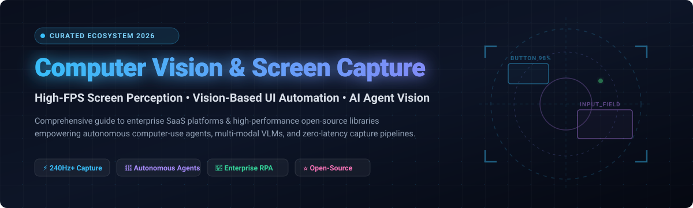

# 👁️ Awesome Computer Vision & Screen Capture Ecosystem 🚀

**A Curated Directory of SaaS Platforms & High-Performance Open-Source Projects for Screen Capture, UI Automation, and Vision-Based AI Agent Perception**

  
  
  
  
  

**Last updated: October 2026** 📅

---

## 📖 Table of Contents

- [🌟 Introduction & Vision](#-introduction--vision)
- [📊 Sector Overview & Market Dynamics](#-sector-overview--market-dynamics)
- [🏢 SaaS & Hosted Platforms](#-saas--hosted-platforms)
- [⚡ Open-Source GitHub Projects](#-open-source-github-projects)
  - [🔥 High-Performance Screen Capture & Perception (Ranked by Stars)](#-high-performance-screen-capture--perception-ranked-by-stars)
  - [🛠️ Emerging & Specialized Libraries](#️-emerging--specialized-libraries)
- [🤝 How to Contribute](#-how-to-contribute)
- [💖 Support](#-support)
- [📈 Star History](#-star-history)
- [⚖️ Disclaimer](#️-disclaimer)

---

## 🌟 Introduction & Vision

This repository tracks notable **enterprise SaaS platforms** and **open-source libraries** for **Computer Vision & Screen Capture**. These technologies enable modern intelligent automation frameworks and autonomous AI agents (such as Computer-Use Agents, Vision-Language Models, and autonomous RPA bots) to perceive live desktop and application states, identify UI elements, parse spatial geometries, and perform precision actions without relying on fragile DOM or accessibility selectors.

Key use-cases include:
- ⚡ **High-FPS Screen Capture**: Sub-millisecond DirectX (DXGI Desktop Duplication) & WinRT capture pipelines powering real-time streaming and model inference.
- 🤖 **Agentic UI Perception & Grounding**: Visual grounding, bounding box detection, and action parsing for multi-modal agents (VLM / OS-World).
- 🏢 **Enterprise Intelligent Automation**: Mission-critical document processing, Citrix/VDI remote automation, and end-to-end workflow orchestration.

---

## 📊 Sector Overview & Market Dynamics

The global **Computer Vision market** is valued between **$23B and $32B** (expanding at an aggressive **14.8% to 20.1% CAGR**), while the specialized **Screen Capture & Screen Recording Software sector** accounts for **$2.1B to $3.2B** (growing at an **8% to 11% CAGR**). 

The sector displays a **bimodal, vertically polarized market structure**:
1. **Core Infrastructure & Cloud Vision (Highly Concentrated)**: Foundational vision hardware (GPUs, edge chips) and hyperscaler cloud vision APIs (Microsoft Azure AI, Google Cloud Vision, AWS Rekognition) are concentrated among a few dominant industry leaders.
2. **Applications, Screen Utilities & Agentic Tooling (Intensely Fragmented)**: The software layer—encompassing screen capture libraries, visual UI automation frameworks, and agent perception wrappers—is **highly fragmented** with continuous influx from open-source innovators and specialized AI startups challenging legacy RPA vendors.

---

## 🏢 SaaS & Hosted Platforms

The table below catalogs enterprise SaaS and hosted automation suites equipped with computer vision and desktop perception. Entries are sorted descending by **Company Size (Valuation / Revenue)**:

| Product | Company Size (Valuation / Revenue) | Starting Price | Free Tier / Trial Limits | Description |
| :--- | :--- | :--- | :--- | :--- |
| **[Microsoft Power Automate](https://powerautomate.microsoft.com/)** | ~$4.01T Mkt Cap / $331.8B Rev | $15 / user / month (Premium); $150 / bot / month (Process) | Free forever (seeded in Windows 10/11 & M365 with standard connectors, capped at 6,000 API requests/user/day); 30-day free trial for Premium RPA | Desktop & cloud automation integrated with Windows, Office 365, UI automation, and AI Builder. |
| **[Blue Prism](https://www.blueprism.com/)** | ~$19.5B Mkt Cap (SS&C) / $6.4B Rev | £840 (~$1,050) / worker / month; Cloud packs from £40k/yr | 30-day free trial (1 digital worker, up to 15 processes); 90–180 day Learning Edition (1 digital worker, 2 sessions, 5 processes, non-production) | Enterprise RPA platform (SS&C) with digital workforce orchestration and process intelligence. |
| **[UiPath Computer Vision](https://www.uipath.com/)** | ~$6.8B Mkt Cap / $1.7B Rev | $25 / month (Basic tier; 1 tenant, max 2 robots) | Free forever (Community Plan: 1 tenant, 1 Pro User, 1 Plus User, 1 Unattended Robot, 1 GB Data Service storage, community support) | Enterprise RPA platform with AI-driven computer vision for Citrix, VDI, and remote desktops. |
| **[Automation Anywhere](https://www.automationanywhere.com/)** | ~$6.8B Valuation / ~$600M+ ARR | $750 / month (Cloud Starter Pack; 1 Creator + 1 Runner) | Free forever (Community Edition: for organizations with <250 machines/users & <$5M revenue, up to 5 machines and 100 doc pages/mo); 30-day Enterprise trial | Cloud-native RPA platform (Automation 360) featuring IQ Bot and document automation. |
| **[Pega Robotic Automation](https://www.pega.com/)** | ~$5.8B Mkt Cap / $1.7B Rev | $97 / user / month (Case/module packs from ~$200k/yr) | 30-day free trial (Community Edition cloud sandbox, extendable once by 15 days up to 45 days total; dev environment with App Studio and Dev Studio) | Enterprise RPA integrated with Pega's AI decisioning, case management, and workflow engine. |
| **[Kofax RPA](https://www.kofax.com/)** | ~$3.0B Valuation (Clearlake/TA) / ~$450M Rev | ~$83 / user / month (Enterprise starter from ~$10,000/yr) | 15–30 day trial for desktop/Transact products; guided enterprise proof-of-concept (POC) sandbox available on request | Enterprise RPA and cognitive capture (Tungsten Automation) with document intelligence. |
| **[Appian RPA](https://www.appian.com/)** | ~$2.8B Mkt Cap / ~$780M Rev | $70 / user / month (Standard tier; ~$1,000/mo flat for <20 users) | Free forever (Community Edition: 1 hosted environment, 1 Appian RPA robot, 15 GB storage, 25k synced record rows, deleted after 28 days inactivity) | Low-code automation platform integrating workflow orchestration with native RPA bots. |
| **[Nintex](https://www.nintex.com/)** | ~$2.0B Valuation (TPG) / ~$240M Rev | $625 / month (Standard workflow automation tier) | 30-day free trial (Full-access cloud sandbox for workflow designer, forms, and connector testing) | Process automation platform encompassing visual workflow, forms, RPA bots, and DocGen. |
| **[ABBYY Vantage](https://www.abbyy.com/)** | ~$1.0B+ Valuation (Marlin) / ~$300M+ Rev | ~$830 / month (~$10,000/yr volume-metered skill subscription) | 60-day free trial (Capped at 2,000 core skill document pages and 1,000 pages per pre-packaged trained skill) | Document AI & intelligent document processing (IDP) platform using pre-trained computer vision skills. |
| **[WorkFusion](https://www.workfusion.com/)** | ~$350M+ Funded / ~$50M+ ARR | $150 / month (Starter AI Agent tier for 100 transactions/mo) | 30-day free trial (First month free for LT AI Agents; covers up to 100 AML/compliance transactions) | Intelligent automation powered by specialized AI Digital Workers for AML, KYC, and financial compliance. |

---

## ⚡ Open-Source GitHub Projects

Open-source screen capture and computer vision repositories provide the backbone for autonomous agents, high-FPS game streamers, and privacy-conscious on-premise automation.

### 🔥 High-Performance Screen Capture & Perception (Ranked by Stars)

Repositories below are strictly sorted descending by GitHub Stars_Count:

1. **[browser-use](https://github.com/browser-use/browser-use)**   
   **Enable AI agents to interact with any website and screen state.** Autonomous agent framework combining multi-modal perception, element clicking, form submission, and live DOM/visual state capture.

2. **[PaddleOCR](https://github.com/PaddlePaddle/PaddleOCR)**   
   **Awesome multilingual OCR toolkits based on PaddlePaddle.** High-efficiency text detection and recognition engine widely used for screen text parsing and document understanding in vision RPA stacks.

3. **[OpenCV](https://github.com/opencv/opencv)**   
   **Open Source Computer Vision Library.** The universal standard for image processing, template matching, edge detection, and real-time visual analysis across desktop automation tools.

4. **[obs-studio](https://github.com/obsproject/obs-studio)**   
   **Free and open-source software for video recording and live streaming.** The reference C/C++ architecture for high-performance desktop, display, and window capture using Direct3D and OpenGL graphics hooks.

5. **[tesseract](https://github.com/tesseract-ocr/tesseract)**   
   **Tesseract Open Source OCR Engine.** The foundational neural-net based optical character recognition engine utilized for extracting text from screen grabs and UI captures.

6. **[ShareX](https://github.com/ShareX/ShareX)**   
   **Screen capture, file sharing and productivity tool.** Feature-packed desktop capture application supporting region grabbing, screen recording, OCR extraction, and automated post-capture workflows.

7. **[flameshot](https://github.com/flameshot-org/flameshot)**   
   **Powerful yet simple-to-use screenshot software.** Cross-platform screen capture tool with in-app annotations, CLI scripting hooks, and instant screen region parsing.

8. **[EasyOCR](https://github.com/JaidedAI/EasyOCR)**   
   **Ready-to-use OCR with 80+ supported languages.** PyTorch-powered optical character recognition library offering straightforward text localized bounding boxes from desktop screenshots.

9. **[MiniCPM-V](https://github.com/OpenBMB/MiniCPM-V)**   
   **Leading edge multimodal vision-language model (VLM).** Powers end-to-end screen understanding, visual question answering, and OCR-free UI parsing for automated agent perception.

10. **[OmniParser](https://github.com/microsoft/OmniParser)**   
    **A screen parsing tool that converts UI screenshots into structured elements.** Developed by Microsoft to empower generalist vision agents by detecting interactable regions and extracting actionable UI labels.

11. **[PyAutoGUI](https://github.com/asweigart/pyautogui)**   
    **Cross-platform GUI automation Python module for humans.** Programmatically controls keyboard and mouse with built-in screenshot pixel matching and coordinate locating capabilities.

12. **[UI-TARS](https://github.com/bytedance/UI-TARS)**   
    **An end-to-end GUI agent model architecture.** Native vision-language model trained specifically to process GUI screen captures and output direct keyboard/mouse action sequences across OS platforms.

13. **[python-mss](https://github.com/BoboTiG/python-mss)**   
    **Ultra-fast cross-platform multiple-screen capture module in pure Python.** Benchmarked at 75+ FPS on Windows without external third-party binary dependencies.

14. **[DXcam](https://github.com/ra1nty/DXcam)**   
    **High-performance Python screen capture library for Windows using Desktop Duplication API.** Capable of 240Hz+ capturing with DXGI and WinRT backends, ring buffers, and zero-copy NumPy array views.

15. **[uDesktopDuplication](https://github.com/hecomi/uDesktopDuplication)**   
    **Desktop Duplication API implementation for Unity.** High-frequency texture streaming directly from the GPU desktop compositor into interactive 3D and machine perception environments.

16. **[ScreenAgent](https://github.com/niuzaisheng/ScreenAgent)**   
    **Vision Language Model-driven computer control agent.** Employs a continuous loop of screen capture, visual reasoning, mouse/keyboard actuation, and self-reflection on desktop operating systems.

17. **[D3DShot](https://github.com/SerpentAI/D3DShot)**   
    **Fast Windows screen capture using Desktop Duplication API.** Provides 118+ FPS capture throughput directly to Pillow, NumPy, and PyTorch tensors.

18. **[BetterCam](https://github.com/dyddnrdld/BetterCam)**   
    **High-performance Python screen capture library.** Focused on low-latency Direct3D exclusive full-screen capture with dedicated Nvidia GPU hardware acceleration.

19. **[DXcamPIL](https://github.com/hite4044/DXcamPIL)**   
    **Lightweight DXcam fork with Pillow support.** Requires only PIL and comtypes, delivering 90+ FPS capture without heavyweight OpenCV binaries.

---

### 🛠️ Emerging & Specialized Libraries

- **[RapidShot](https://pypi.org/project/rapidshot/)** — DXcam successor with GPU-resident frames, sub-millisecond BGRA→RGB color conversion, and intelligent `timeout_ms` compositor pacing (118+ FPS at just 15.7% CPU).
- **[OAGI (Open Agent GUI Interface)](https://pypi.org/project/oagi-core/)** — Vision-based task automation SDK featuring `single_step()` screenshot analysis, token-optimized image compression, and PyAutoGUI control.
- **[Screenwise Framework](https://pypi.org/project/t-screenwise/)** — UI element detection framework featuring OCR spatial analysis (`get_nearest_boxes()`) and live interactive capture modes.
- **[Chivel](https://socket.dev/pypi/package/chivel/overview/0.8.1)** — Ultra-concise computer vision and OCR toolkit featuring `find_image()`, `find_text()`, and asynchronous condition polling.
- **[rustcam](https://socket.dev/pypi/package/rustcam/overview/0.1.2)** — Rust-native desktop capture engine clocking 157+ FPS for maximum throughput and memory safety.

---

## 🤝 How to Contribute

Contributions are welcome to keep this directory comprehensive and up to date! 🚀

1. 🍴 Fork the repository.
2. 📝 Add or update entries in `README.md` (keep descriptions concise, factual, and formatted according to existing tables/lists).
3. 🔗 Verify that all URLs, links, and pricing details are accurate and functional.
4. 📬 Submit a Pull Request detailing your changes.

---

## 💖 Support

If you find this ecosystem directory helpful for your research, agents, or automation pipelines:
- ⭐ **Star this repository** to show your support and help others discover it!
- 🍴 **Fork and share** it with your developer community.
- ☕ **Sponsor the maintainer**: Support ongoing curation and open-source contributions by [buying a coffee on the Sponsor Dashboard](https://github.com/sponsors/ishandutta2007)! 🚀

---

## 📈 Star History

---

## ⚖️ Disclaimer

- This is a community-curated collection intended for educational, research, and technical evaluation purposes.
- Screen capture and computer vision technologies can capture sensitive data. Ensure you maintain compliance with privacy laws, workplace data governance policies, and explicit user consent before deploying capture agents.
